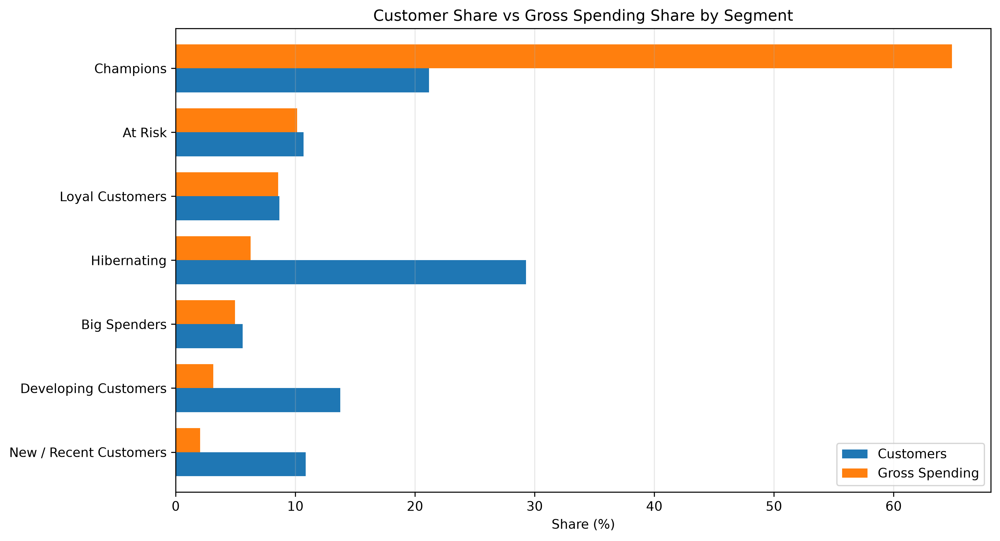

# Customer Segmentation Report

## 1. Executive Summary

I analysed 4,295 customers from the 2009–2010 Online Retail II dataset, covering £8.68 million in gross merchandise spending.

Using RFM analysis, I grouped customers into seven segments to understand their buying habits and identify opportunities to improve retention.

**Key findings**

- **Champions:** 909 customers generated 64.88% of total spending.
- **High-value Champions:** Just 46 customers accounted for 28.90% of spending.
- **At Risk:** 459 customers spent £880,617 historically. Among them, 170 recently inactive, high-priority customers accounted for £494,725.
- **Hibernating:** 1,257 customers represented 29.27% of the customer base but only 6.26% of spending.

The main finding is that a relatively small group of customers drives most of the spending.

**Recommendations**

Focus on keeping high-value customers engaged, test win-back campaigns for recently inactive customers, and explore low-cost ways to reconnect with less active customers.

These recommendations are based on past purchasing behaviour and would need further testing.

## 2. Methodology

I used RFM analysis to group customers based on three measures:

- **Recency:** Days since their last purchase.
- **Frequency:** Number of unique purchase invoices.
- **Monetary:** Total gross merchandise spending.

The analysis covers 4,295 identified customers, using 10 December 2010 as the reference date.

I excluded transactions without customer IDs and selected non-merchandise entries. Cancellations were not deducted from gross spending.

Each customer received an RFM score from 1 to 5. I used quintile thresholds for Recency and Monetary, and fixed bands for Frequency to handle repeated values.

I then assigned customers to seven mutually exclusive segments using ordered RFM rules.

For further analysis, I identified the top 5% of Champions by spending and divided At Risk customers into three reactivation priority groups.

The analysis describes historical purchasing behaviour rather than predicting future sales or customer churn.

## 3. Customer Segmentation Results

The RFM analysis identified seven customer segments.

| Segment | Customers | Customer Share | Spending Share |
|---|---:|---:|---:|
| Champions | 909 | 21.16% | 64.88% |
| At Risk | 459 | 10.69% | 10.15% |
| Loyal Customers | 372 | 8.66% | 8.56% |
| Hibernating | 1,257 | 29.27% | 6.26% |
| Big Spenders | 240 | 5.59% | 4.96% |
| Developing Customers | 591 | 13.76% | 3.15% |
| New / Recent Customers | 467 | 10.87% | 2.05% |

### Main Findings

**Champions drive most spending.** Although they represent only 21.16% of customers, they account for 64.88% of historical gross spending.

**At Risk customers are worth investigating.** They contributed £880,617 historically, suggesting an opportunity to test targeted reactivation campaigns.

**Hibernating customers form the largest group.** They represent 29.27% of customers but contribute just 6.26% of spending.

Overall, customer spending is unevenly distributed, making it important to consider both customer activity and historical value when planning retention strategies.

### Customer Segmentation Visualisation

## 4. High-Value Customers and Reactivation Opportunities

### 4.1 High-Value Champions

The 909 Champions generated £5.63 million in historical gross spending.

Spending was concentrated among a small number of customers:

- The top 46 Champions (5% of the segment) generated £2.51 million.
- These 46 customers accounted for 44.54% of Champions' spending and 28.90% of total customer spending.

This suggests that maintaining relationships with high-value customers should be a priority.

### 4.2 At Risk Customers

The 459 At Risk customers generated £880,617 in historical spending.

I identified 200 high-priority customers based on their previous spending and purchase frequency. Together, they accounted for £629,703, or 71.51% of At Risk spending.

I then divided the segment into three reactivation audiences:

| Reactivation Audience | Customers | Historical Spending |
|---|---:|---:|
| Priority 1 — Recently At Risk | 170 | £494,725 |
| Priority 2 — Long-Inactive At Risk | 30 | £134,978 |
| Priority 3 — Remaining At Risk | 259 | £250,915 |

The 170 recently inactive, high-priority customers are a reasonable starting point for testing reactivation campaigns.

For the 30 long-inactive customers, spending is concentrated among a few accounts, making individual follow-up worth exploring.

These opportunities are based on historical spending, not guaranteed future revenue.

## 5. Business Recommendations

Based on the findings, I recommend three actions:

**1. Retain high-value customers**

Champions generated 64.88% of historical spending. The retailer should focus on maintaining these relationships through personalised offers, loyalty programmes and regular engagement.

**2. Test targeted reactivation campaigns**

Start with the 170 recently inactive, high-priority customers who previously generated £494,725. Test personalised reminders or incentives and measure how many return to purchase.

**3. Use low-cost engagement for less active customers**

Hibernating customers represent 29.27% of the customer base but only 6.26% of spending. Low-cost email campaigns may be more suitable than expensive individual outreach.

## 6. Limitations

- The analysis covers historical data from 2009–2010.
- Customers without IDs were excluded.
- Selected non-merchandise transactions were excluded from behavioural analysis.
- Spending figures are gross and do not account for cancellations, costs or profit.
- RFM segmentation describes past behaviour but cannot predict churn or campaign success.

## 7. Conclusion

The analysis shows that a relatively small group of customers accounts for most historical spending.

By identifying high-value customers and those showing signs of inactivity, the retailer can make more informed decisions about retention and reactivation.

The next step would be to test these strategies and measure their impact on repeat purchases and profitability.