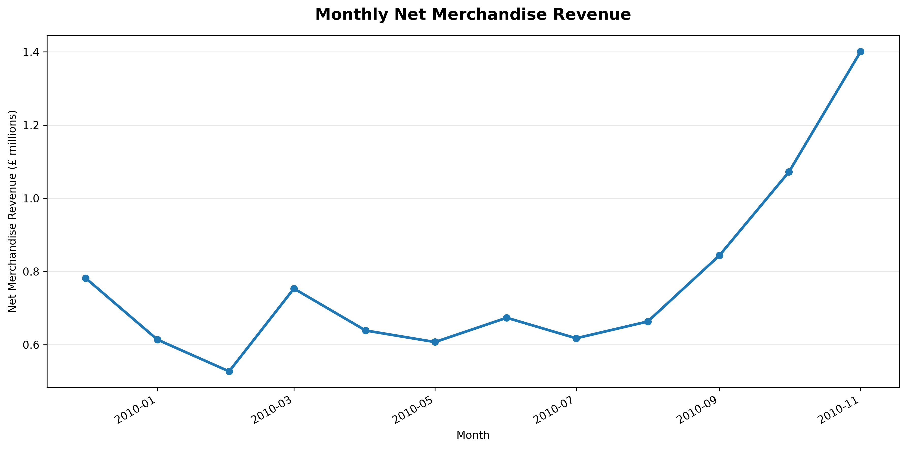
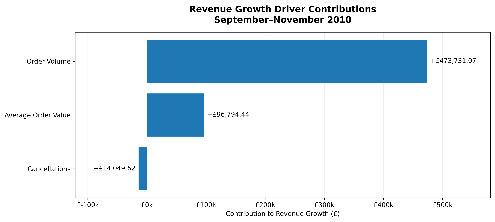
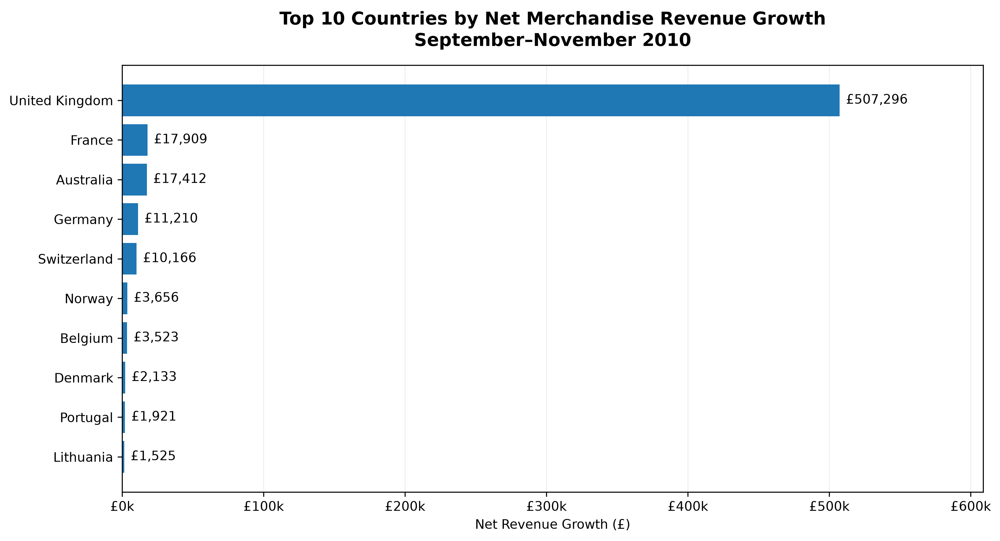
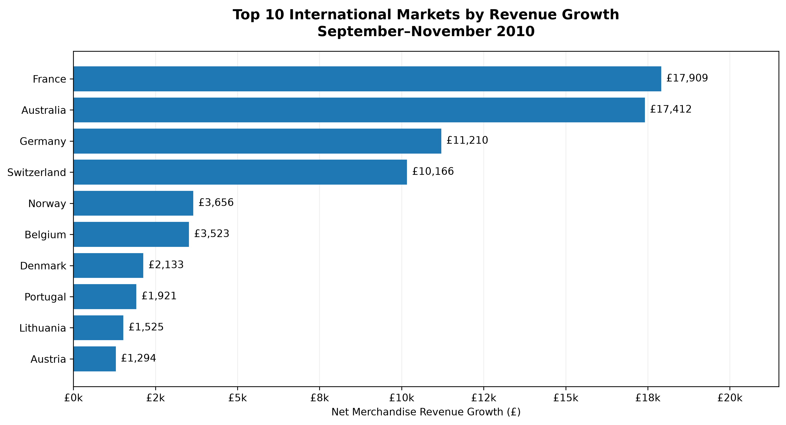
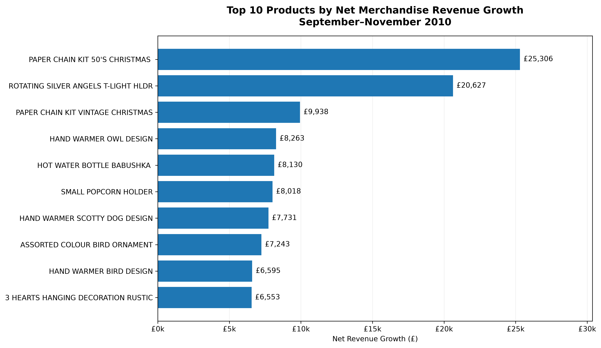
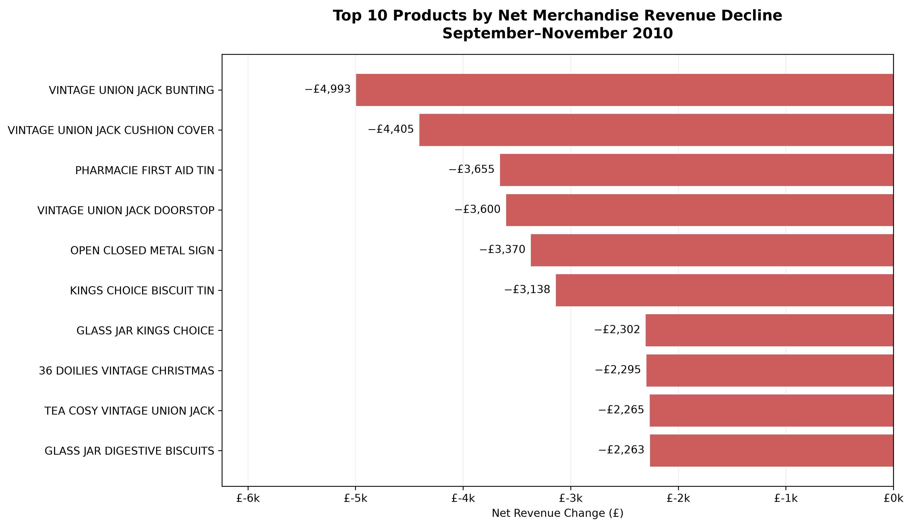
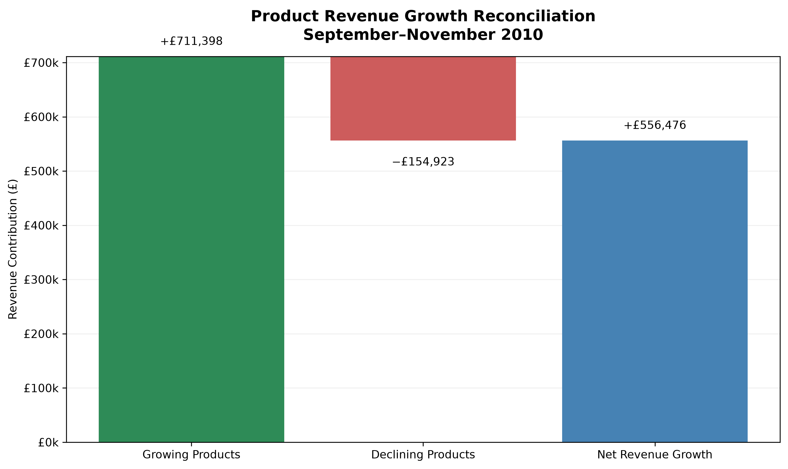

# Retail Revenue Growth Driver Analysis

## Executive Summary

The analysis investigates the drivers of revenue growth for a UK-based online retailer using the UCI Online Retail II dataset.

Between September and November 2010, net merchandise revenue increased by **65.92%, from £844,134.41 to £1,400,610.30**, representing an increase of **£556,475.89**.

The main driver was increased order volume, which accounted for **83.03% of gross merchandise revenue growth**, while higher average order value contributed 16.97%. Increased cancellations partially offset these gains.

Geographically, the United Kingdom contributed **91.16% of net revenue growth**, highlighting the concentration of growth in the retailer's domestic market.

At product level, 2,203 products recorded revenue increases, while 990 experienced declines. Declining products offset 21.78% of positive product growth. Christmas decorations and cold-weather merchandise featured prominently among the highest-growing products, suggesting a possible seasonal influence.

Based on these findings, the analysis recommends three priorities:

1. **Improve seasonal inventory forecasting** to prepare for periods of increased demand.
2. **Review underperforming product lines** to support better assortment and inventory decisions.
3. **Evaluate international growth opportunities** through further market analysis and controlled testing.

These recommendations are based on historical transaction patterns. Additional inventory, profitability and customer data would be required to validate their commercial impact.

## 1. Business Problem

The retailer experienced substantial revenue growth between September and November 2010. However, an increase in revenue alone does not explain which business activities or customer purchasing patterns contributed to that performance.

Understanding these drivers is important for making informed decisions about inventory planning, product assortment and future growth opportunities.

**Primary business question:**

What drove the retailer's revenue growth between September and November 2010, which markets and products contributed most, and what practical actions could improve future performance?

**Analytical objectives:**

1. Measure net merchandise revenue growth between September and November 2010.
2. Determine how changes in order volume and average order value contributed to gross revenue growth.
3. Quantify the impact of cancellations on net revenue.
4. Identify the countries and products contributing most to revenue growth.
5. Investigate declining products and their impact on overall performance.
6. Develop evidence-based business recommendations while acknowledging the dataset's limitations.

**Business value:**

The analysis aims to help decision-makers understand where revenue growth originated, identify potential risks and opportunities, and prioritise areas for further investigation.

Rather than assuming that historical growth will continue, the findings provide a basis for testing practical business improvements.

## 2. Dataset and Methodology

### 2.1 Dataset Overview

The analysis uses the **UCI Online Retail II dataset**, containing historical transactions from a UK-based online retailer.

The investigation focuses on the `Year 2009-2010` worksheet, containing **525,461 transaction records**.

The dataset includes invoice numbers, product codes, descriptions, quantities, transaction dates, unit prices, customer identifiers and countries.

The primary comparison examines revenue performance between **September and November 2010**.

### 2.2 Data Preparation and Transaction Classification

Transaction records were assessed to distinguish merchandise sales from cancellations, adjustments, charges and other non-merchandise transactions.

Gross merchandise sales were defined as transactions with positive quantities and prices, excluding cancellation invoices and identified non-merchandise stock codes.

Cancellation transactions were identified using invoice numbers beginning with `C`. Their signed transaction values were included when calculating net merchandise revenue.

The following stock codes were excluded from merchandise revenue:

`M`, `POST`, `DOT`, `C2`, `D`, `BANK CHARGES`, `PADS`, `TEST001`

These exclusions were applied consistently across the revenue, country and product analyses.

### 2.3 Revenue Calculation

Transaction values were calculated as:

**Line Value = Quantity × Unit Price**

The following revenue definitions were applied:

- **Gross merchandise revenue:** Sum of eligible positive sales transactions.
- **Merchandise cancellations:** Signed value of eligible cancellation transactions.
- **Net merchandise revenue:** Gross merchandise revenue plus merchandise cancellations.

After applying the exclusions, the dataset produced:

| Metric | Value |
|---|---:|
| Gross merchandise revenue | £9,869,770.12 |
| Merchandise cancellations | −£312,508.79 |
| Net merchandise revenue | £9,557,261.33 |

### 2.4 Growth Driver Analysis

Revenue growth was examined through changes in order volume and average order value (AOV).

Order volume represents the number of distinct invoices containing eligible gross merchandise sales.

AOV was calculated by dividing gross merchandise revenue by the number of orders.

A symmetric decomposition method was used to allocate gross revenue changes between order volume and AOV, without assigning the interaction effect entirely to either factor.

Changes in merchandise cancellations were then incorporated to reconcile gross revenue growth with net revenue growth.

### 2.5 Geographic and Product Analysis

Net merchandise revenue was grouped by country and product stock code.

For each group, the change between September and November 2010 was calculated to identify positive and negative contributions.

Product contributions were also divided into growing, declining and unchanged groups.

### 2.6 Data Validation

Six reconciliation checks were performed, covering dataset revenue, monthly revenue, growth decomposition, country contributions, product contributions and positive versus negative product growth.

All six checks passed.

The checks establish internal consistency between the calculations, but do not independently validate every transaction classification.

### 2.7 Analysis Scope

The analysis uses historical transactional data and does not establish causal relationships.

December 2010 was excluded from the primary comparison because it represents a partial month in the selected worksheet.

## 3. Revenue Performance

### 3.1 Revenue Growth Overview

Net merchandise revenue increased from **£844,134.41 in September 2010 to £1,400,610.30 in November 2010**, representing growth of **£556,475.89 (65.92%)**.

Gross merchandise revenue increased by £570,525.51 over the same period. However, the value of merchandise cancellations also increased, reducing the overall net revenue gain.

### 3.2 Monthly Revenue Comparison

| Metric | September 2010 | October 2010 | November 2010 |
|---|---:|---:|---:|
| Gross merchandise revenue | £871,912.38 | £1,098,145.32 | £1,442,437.89 |
| Merchandise cancellations | −£27,777.97 | −£26,279.36 | −£41,827.59 |
| Net merchandise revenue | £844,134.41 | £1,071,865.96 | £1,400,610.30 |

Net merchandise revenue increased in both October and November, indicating sustained month-on-month growth during the comparison period.

#### Monthly Revenue Trend

*Figure 1. Monthly net merchandise revenue from December 2009
to November 2010. December 2010 is excluded because it
represents a partial month.*

### 3.3 Business Interpretation

The retailer experienced substantial revenue growth leading into the November trading period.

However, revenue growth alone does not establish whether performance improved because of additional orders, higher spending per order or changes in product demand.

These factors are examined in the following sections.

### 3.4 Important Consideration

The analysis covers a historical three-month period. The observed increase should not automatically be interpreted as a sustainable long-term growth trend.

The December 2010 data is incomplete and is therefore unsuitable for a direct full-month comparison.

## 4. Growth Driver Decomposition

### 4.1 Order Volume and Average Order Value

Between September and November 2010, the number of merchandise orders increased from **1,789 to 2,720**, representing growth of **52.04%**.

Average order value (AOV) also increased, from **£487.37 to £530.31**, representing growth of **8.81%**.

These changes contributed to the increase in gross merchandise revenue.

| Metric | September 2010 | November 2010 | Change |
|---|---:|---:|---:|
| Orders | 1,789 | 2,720 | +52.04% |
| AOV | £487.37 | £530.31 | +8.81% |
| Gross merchandise revenue | £871,912.38 | £1,442,437.89 | +£570,525.51 |

### 4.2 Revenue Growth Decomposition

A symmetric decomposition method was applied to separate the effects of changes in order volume and average order value.

The results show:

| Growth driver | Revenue contribution | Share of gross growth |
|---|---:|---:|
| Order volume | +£473,731.07 | 83.03% |
| Average order value | +£96,794.44 | 16.97% |
| **Total gross revenue growth** | **+£570,525.51** | **100.00%** |

Order volume was the dominant contributor to gross merchandise revenue growth.

#### Revenue Growth Driver Contributions

*Figure 2. Contributions of order volume, average order value and cancellations to the £556,475.89 increase in net merchandise revenue between September and November 2010.*

### 4.3 Cancellation Impact

Merchandise cancellations increased in magnitude from £27,777.97 in September to £41,827.59 in November.

This produced a negative revenue contribution of **£14,049.62**.

After incorporating cancellations, the total net merchandise revenue increase was **£556,475.89**.

The decomposition reconciled with the actual net revenue change, with a difference of £0.00.

### 4.4 Business Interpretation

The retailer's revenue growth was primarily associated with a higher number of orders rather than substantially higher spending per order.

This suggests that understanding the factors associated with increased transaction volume should be a priority for further investigation.

However, the dataset does not establish whether the additional orders resulted from new customers, repeat purchases, promotions or other external factors.

Further customer-level and marketing analysis would be required to distinguish between these explanations.

## 5. Geographic Revenue Contributions

### 5.1 Overview

Geographic analysis was conducted to identify which countries
contributed most to the increase in net merchandise revenue
between September and November 2010.

The analysis shows that revenue growth was heavily concentrated
in the United Kingdom, although several international markets
also recorded positive contributions.

### 5.2 United Kingdom vs International Markets

| Market | Net Revenue Growth | Share of Total Growth |
|---|---:|---:|
| United Kingdom | £507,296.32 | 91.16% |
| International markets (combined) | £49,179.57 | 8.84% |
| **Total** | **£556,475.89** | **100.00%** |

The United Kingdom accounted for approximately 91% of total
net revenue growth. This indicates substantial geographic
concentration in the retailer's domestic market.

### 5.3 Geographic Revenue Growth

*Figure 3. Top 10 countries by absolute net merchandise revenue
growth between September and November 2010.*

### 5.4 International Market Comparison

Excluding the United Kingdom provides a clearer view of
international market performance.

| Country | Net Revenue Growth |
|---|---:|
| France | £17,909.03 |
| Australia | £17,411.99 |
| Germany | £11,209.97 |
| Switzerland | £10,166.29 |
| Norway | £3,655.63 |
| Belgium | £3,523.22 |
| Denmark | £2,133.11 |
| Portugal | £1,920.54 |
| Lithuania | £1,525.39 |
| Austria | £1,294.18 |

*Figure 4. Top 10 international markets by absolute net
merchandise revenue growth, excluding the United Kingdom.*

France and Australia recorded the largest positive international
contributions. However, these results represent absolute
revenue changes rather than market growth rates.

The combined performance of all international markets also
includes countries that recorded declining revenue.

### 5.5 Business Implications

The findings suggest three potential priorities:

1. **Protect domestic performance:** Maintain adequate inventory
   and operational capacity in the United Kingdom, where most
   of the observed revenue growth originated.

2. **Investigate international opportunities:** Examine demand,
   customer retention, shipping costs and profitability in
   markets such as France, Australia, Germany and Switzerland.

3. **Monitor geographic concentration:** Track revenue
   contributions across countries to understand the business's
   dependence on its domestic market.

These findings describe observed revenue movements and do
not establish the underlying causes of growth.

## 6. Product Performance Analysis

### 6.1 Product Growth Overview

Product-level analysis identified **3,254 stock codes** with recorded revenue activity in at least one of the comparison months.

Of these:

- 2,203 products (67.70%) recorded revenue increases.
- 990 products (30.42%) recorded revenue declines.
- 61 products (1.87%) recorded no change.

Growing products contributed **£711,398.49** in additional revenue. Declining products offset **£154,922.60**, resulting in a net merchandise revenue increase of **£556,475.89**.

### 6.2 Highest-Growing Products

| Product | Revenue Increase |
|---|---:|
| Paper Chain Kit 50's Christmas | +£25,306.09 |
| Rotating Silver Angels T-Light Holder | +£20,627.31 |
| Paper Chain Kit Vintage Christmas | +£9,938.45 |
| Hand Warmer Owl Design | +£8,262.67 |
| Hot Water Bottle Babushka | +£8,130.11 |
| Small Popcorn Holder | +£8,017.61 |
| Hand Warmer Scotty Dog Design | +£7,730.92 |
| Assorted Colour Bird Ornament | +£7,242.72 |
| Hand Warmer Bird Design | +£6,594.54 |
| 3 Hearts Hanging Decoration Rustic | +£6,553.36 |

The 10 highest-growing products contributed **£108,403.78**, equivalent to **19.48% of total net revenue growth**.

Christmas decorations, home accessories and cold-weather products featured prominently among these products.

This pattern is consistent with increased seasonal purchasing ahead of Christmas, although seasonality has not been independently established as the cause.

### 6.3 Declining Products

Revenue declined for 990 products, with combined decreases of **£154,922.60**.

Several Vintage Union Jack products experienced substantial declines.

| Product | Revenue Decline |
|---|---:|
| Vintage Union Jack Bunting | −£4,992.94 |
| Vintage Union Jack Cushion Cover | −£4,405.15 |
| Pharmacie First Aid Tin | −£3,655.42 |
| Vintage Union Jack Doorstop | −£3,600.34 |
| Open Closed Metal Sign | −£3,369.60 |

Declining products offset **21.78% of the positive revenue growth** generated by growing products.

### 6.4 Business Interpretation

Revenue growth was distributed across a substantial proportion of the product catalogue rather than being concentrated exclusively among the 10 highest-growing products.

However, the performance of individual products varied considerably.

The results suggest that the retailer could benefit from reviewing product demand patterns, particularly when preparing inventory for seasonal trading periods.

Products experiencing declining revenue should be investigated before decisions are made about replenishment, promotions or discontinuation.

### 6.5 Limitations

Product revenue changes do not necessarily reflect changes in underlying customer demand.

The dataset does not establish whether declining sales resulted from stockouts, discontinued products, price changes or shifting customer preferences.

Product profitability also cannot be determined without procurement costs, operating expenses and margin information.

Consequently, revenue performance should be used as a starting point for product-level investigation rather than as the sole basis for assortment decisions.

### 6.6 Product Growth and Decline Visualisations

#### Top 10 Growing Products

*Figure 5. The 10 products contributing the largest positive
changes in net merchandise revenue between September
and November 2010.*

#### Top 10 Declining Products

*Figure 6. The 10 products recording the largest negative
changes in net merchandise revenue over the same period.*

### 6.7 Product Growth Reconciliation

*Figure 7. Reconciliation of positive and negative product-level
revenue changes to total net merchandise revenue growth
between September and November 2010.*

The product-level reconciliation confirms that revenue growth
was driven by gains across 2,203 products, partially offset by
declines across 990 products.

| Component | Revenue Contribution |
|---|---:|
| Growing products | +£711,398.49 |
| Declining products | −£154,922.60 |
| **Net revenue growth** | **+£556,475.89** |

The decline in underperforming products offset approximately
21.78% of the positive revenue contribution from growing
products.

This reconciliation confirms that the product-level analysis
matches the overall net revenue growth calculated in the
revenue performance analysis.

## 7. Business Recommendations

### 7.1 Improve Seasonal Inventory Planning

**Evidence:** Net merchandise revenue increased by 65.92% between September and November 2010, while order volume increased by 52.04%. Christmas decorations and cold-weather products featured prominently among the highest-growing products.

**Recommendation:** Use historical sales patterns to improve demand forecasting ahead of autumn and Christmas trading periods. Review product-level sales trends and prioritise inventory planning for merchandise with recurring seasonal demand.

**Expected benefit:** Better product availability during periods of increased demand, with potentially fewer stockouts and less excess inventory.

**Performance indicators:**
- Forecast accuracy
- Stockout rate
- Inventory turnover
- Product-level sell-through rate

**Limitation:** Inventory levels and stockout information are unavailable in the dataset. The recommendation therefore requires further validation.

### 7.2 Review Underperforming Product Lines

**Evidence:** Revenue declined for 990 products, reducing the gains from growing products by £154,922.60. These declines offset 21.78% of positive product growth.

**Recommendation:** Introduce regular product performance reviews to identify declining merchandise. Investigate stock availability, pricing, demand patterns and product profitability before making decisions about replenishment, promotions or discontinuation.

**Expected benefit:** More effective inventory allocation, improved product assortment decisions and reduced exposure to slow-moving merchandise.

**Performance indicators:**
- Product-level revenue growth
- Sell-through rate
- Inventory turnover
- Gross profit margin

**Limitation:** Declining revenue does not necessarily indicate poor profitability or declining customer demand. Additional cost and inventory information is required.

### 7.3 Evaluate International Growth Opportunities

**Evidence:** The United Kingdom contributed £507,296.32, representing 91.16% of net merchandise revenue growth. France, Australia, Germany and Switzerland also recorded positive revenue contributions.

**Recommendation:** Investigate international markets showing positive sales momentum. Compare revenue trends, customer purchasing behaviour, fulfilment costs and contribution margins before selecting markets for small-scale expansion tests.

**Expected benefit:** Identification of commercially viable growth opportunities and potential diversification of revenue sources.

**Performance indicators:**
- Country-level revenue growth
- Average order value by country
- Repeat purchase rate
- Customer acquisition cost
- Contribution margin by market

**Limitation:** The dataset does not include shipping costs, acquisition costs or market-level profitability. International expansion cannot be justified on revenue growth alone.

### 7.4 Recommended Implementation Approach

The retailer should prioritise further validation before committing significant resources.

A practical sequence would be:

1. Review historical seasonal demand and inventory availability.
2. Investigate the products with the largest revenue declines.
3. Assess international market profitability and operational feasibility.
4. Test selected improvements on a limited scale.
5. Monitor performance against predefined indicators before expanding successful initiatives.

These recommendations are intended to support evidence-based decisions rather than guarantee future revenue growth.

## 8. Limitations

### 8.1 Historical Data and Analysis Period

The analysis uses historical transaction data from the UCI Online Retail II dataset, focusing on September to November 2010.

The findings describe performance during this period and should not be assumed to represent current market conditions or long-term growth trends.

December 2010 was excluded from the primary comparison because it is an incomplete month in the selected worksheet.

### 8.2 Transaction Classification

Merchandise revenue was calculated after excluding identified non-merchandise transactions, including postage charges, discounts, manual adjustments and test records.

Although reconciliation checks confirmed that the calculations were internally consistent, some transaction classifications may require further investigation.

Different classification rules could produce different revenue totals.

### 8.3 Missing Inventory and Profitability Data

The dataset does not contain inventory levels, procurement costs, fulfilment expenses or product profit margins.

Consequently, the analysis cannot establish whether declining product revenue resulted from stock shortages, lower customer demand or deliberate product discontinuation.

It also cannot determine which products or geographic markets were most profitable.

### 8.4 Customer Behaviour and Marketing

Order volume was the largest contributor to gross merchandise revenue growth.

However, the analysis does not establish whether additional orders resulted from new customers, repeat purchases, marketing campaigns, promotions or other factors.

Further customer-level and marketing data would be required to investigate these explanations.

### 8.5 Seasonality and Causation

Christmas decorations and cold-weather merchandise featured prominently among the highest-growing products.

Although this pattern is consistent with seasonal purchasing, the analysis does not establish that seasonality caused the observed revenue increase.

Comparisons across multiple years and additional contextual information would be needed to evaluate recurring seasonal effects.

### 8.6 Geographic Analysis

Country-level revenue growth does not necessarily indicate market attractiveness or commercial profitability.

The dataset lacks information about shipping costs, customer acquisition expenses, competitive conditions and market size.

International expansion recommendations therefore require further commercial evaluation.

### 8.7 Interpretation of Revenue Growth

The decomposition quantifies the contributions of order volume, average order value and cancellations to recorded revenue growth.

It is an accounting-based decomposition rather than a causal model.

The findings should therefore support further investigation and controlled business testing rather than be interpreted as proof that specific interventions will increase future revenue.

## 9. Conclusion

The analysis found that net merchandise revenue increased by **£556,475.89 (65.92%)** between September and November 2010.

The main contributor was increased order volume, accounting for **83.03% of gross merchandise revenue growth**, compared with 16.97% from higher average order value. Increased cancellations partially offset these gains.

Geographically, the United Kingdom generated **91.16% of net revenue growth**, while international markets made smaller contributions.

Product-level analysis showed that growth extended across much of the catalogue, with **2,203 products recording revenue increases**. However, declines across 990 products offset 21.78% of positive product growth. Christmas decorations and cold-weather merchandise were prominent among the highest-growing products.

Together, these findings suggest three priorities: improving seasonal inventory planning, reviewing underperforming products and evaluating international growth opportunities.

The analysis demonstrates how transaction-level data can be used to identify revenue growth drivers and support business decision-making. However, additional inventory, profitability and customer data would be needed to validate the recommendations and assess their potential commercial impact.

## 10. Reproducibility and References

### 10.1 Data Source

**Dataset:** Online Retail II  
**Provider:** UCI Machine Learning Repository  
**Source:** https://archive.ics.uci.edu/dataset/502/online+retail+ii

The dataset contains historical transactions from a UK-based online retailer between December 2009 and December 2011.

This analysis uses the `Year 2009-2010` worksheet.

The original dataset is not included in the GitHub repository and must be downloaded separately.

### 10.2 Tools and Technologies

The analysis was conducted using:

- **Python:** Data preparation and analytical calculations.
- **pandas:** Data cleaning, aggregation and revenue analysis.
- **NumPy:** Numerical validation and reconciliation.
- **JupyterLab:** Interactive analysis and documentation.
- **Git and GitHub:** Version control and project documentation.

### 10.3 Reproducing the Analysis

To reproduce the results:

1. Clone the GitHub repository.
2. Create and activate a Python virtual environment.
3. Install the dependencies listed in `requirements.txt`.
4. Download the Online Retail II dataset from the UCI Machine Learning Repository.
5. Save the Excel workbook as `data/raw/online_retail_II.xlsx`.
6. Open `notebooks/04_revenue_growth_drivers.ipynb` in JupyterLab.
7. Run the notebook cells sequentially to reproduce the calculations.

The notebook documents the merchandise revenue definition, transaction exclusions, growth decomposition, country analysis and product analysis.

### 10.4 Validation

Six reconciliation checks were performed to confirm internal consistency across the calculations.

All six checks passed.

The checks cover:

- Dataset revenue reconciliation.
- Monthly revenue reconciliation.
- Growth driver decomposition.
- Country-level revenue contributions.
- Product-level revenue contributions.
- Positive and negative product growth reconciliation.

These checks confirm mathematical consistency but do not independently validate every underlying transaction classification.

### 10.5 Project Repository

**GitHub:** https://github.com/baizoukou/retail-revenue-growth-analysis

**Main analytical notebook:** `notebooks/04_revenue_growth_drivers.ipynb`

**Growth driver report:** `reports/03_growth_driver_report.md`

### 10.6 Reference

Chen, D. (2019). *Online Retail II* [Dataset]. UCI Machine Learning Repository. https://doi.org/10.24432/C5CG6D
